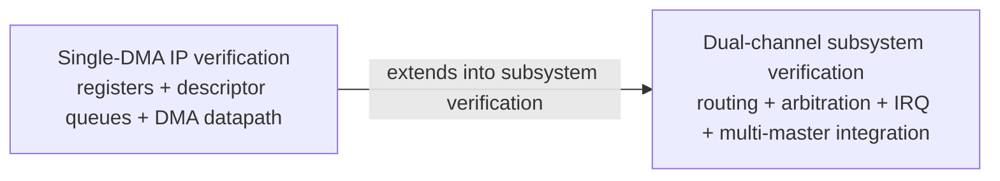
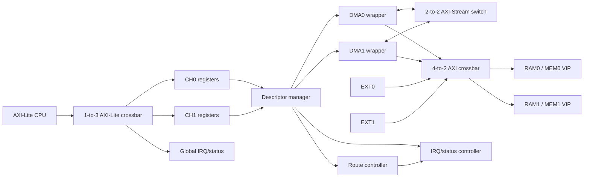
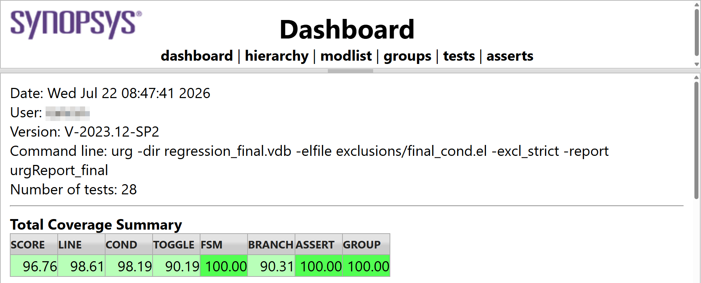
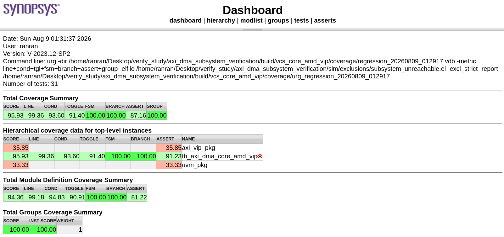

# AXI4 DMA Subsystem Verification


This repository contains two complementary SystemVerilog/UVM verification projects for an AXI4 memory-to-memory DMA design:

1. **`axi_dma_ip_verification/`** verifies a self-contained, single-DMA integration with one AXI4-Lite control port, one AXI4 memory master, queued descriptors/completions, an internal AXI4-Stream FIFO, and a verification RAM/proxy.
2. **`axi_dma_subsystem_verification/`** verifies the larger two-channel subsystem: two DMA engines, two external AXI masters, a 4-to-2 AXI crossbar, a 2-to-2 AXI-Stream switch, per-channel control blocks, shared routing, IRQ/status logic, and two memory targets represented by AMD AXI VIP.

The first project covers the DMA engine, descriptor manager, registers, data integrity, and error handling. The second extends that coverage to multi-initiator arbitration, cross-memory routing, concurrent completion ordering, subsystem IRQ behavior, reset/abort interaction, and integration-level fault handling.

The recorded Synopsys VCS/URG `V-2023.12-SP2` baselines passed: the 28-test IP regression reached **96.76%** overall coverage, and the 31-test subsystem regression reached **95.93%**. Detailed metrics and reports are available in [Verification results](#7-verification-results). The maintained subsystem suite now contains 32 tests, including an independent IRQ state model and a multi-master random stress test. The recorded coverage results predate these additions.

## 1. Verification levels at a glance

| Item | Single-DMA IP verification | Dual-channel subsystem verification |
|---|---|---|
| Project | [`axi_dma_ip_verification/`](axi_dma_ip_verification/) | [`axi_dma_subsystem_verification/`](axi_dma_subsystem_verification/) |
| Primary DUT | `axi_dma_subsystem` | `axi_dma_subsystem_core` |
| DMA channels | 1 | 2 |
| Software control | One custom AXI4-Lite slave and 14 registers | 1-to-3 AXI4-Lite crossbar; CH0, CH1, and global blocks |
| Memory initiators | One DMA AXI4 master | DMA0, DMA1, EXT0, and EXT1 |
| Memory targets | One shared 64-KiB RAM model | RAM0 and RAM1, 64 KiB each |
| Stream routing | One internal 32-bit FIFO | 2-to-2 32-bit AXI-Stream switch with route ownership |
| Memory verification interface | Project HDL proxy plus AXI RAM | Five generated AMD AXI VIP instances: CPU, EXT0, EXT1, MEM0, MEM1 |
| Reference memory | Dense, byte-addressable 64-KiB model | Independent sparse byte-addressable model |
| Regression | 28 tests, PASS | 31 tests, PASS |
| Functional coverage | 7 covergroups, 43 coverpoints, 7 crosses | 11 covergroups, 65 coverpoints, 8 crosses |
| Project SVA | 30 assertions and 19 cover properties | Checker defines 21 assertions and 5 cover properties; bound to both memory interfaces |
| Functional covergroups | 100.00% | 100.00% |
| Overall coverage | 96.76% | 95.93% |
| Commercial VIP required | No | Yes; generated AMD VIP sources are external |



## 2. Repository layout

```text
.
├── README.md
├── LICENSE
├── .gitattributes
├── axi_dma_ip_verification/
│   ├── README.md
│   ├── rtl/                         Single-DMA integration and vendored DMA RTL
│   ├── tb/                          UVM environment, RAM/proxy, SVA, tests
│   ├── sim/                         VCS single-test and 28-test regression flows
│   └── docs/                        Specification, plan, cases, coverage, PDF/images
└── axi_dma_subsystem_verification/
    ├── README.md
    ├── rtl/                         Two-channel subsystem and vendored interconnect RTL
    ├── tb/                          AMD-VIP UVM environment, SVA, tests
    ├── sim/                         VCS/URG 32-test launcher, multi-seed stress flow
    └── docs/                        Scenarios, VIP dependency, waiver rationale, results
```

## 3. Single-DMA IP verification

The detailed project guide is [`axi_dma_ip_verification/README.md`](axi_dma_ip_verification/README.md). Despite the historical RTL top name `axi_dma_subsystem`, this directory is the single-DMA verification tier.

### 3.1 RTL behavior and tested configuration

Software stages a descriptor through AXI4-Lite, writes `SUBMIT`, and receives a completion through a four-entry completion FIFO. The manager validates the descriptor before admission, dispatches the destination write descriptor before the source read descriptor, waits for both DMA status channels, and commits one in-order completion. Up to four requests can be queued, but only one descriptor executes at a time.

```text
AXI4 memory read
    -> axi_dma_rd
    -> internal 32-bit AXI4-Stream
    -> axis_fifo
    -> axi_dma_wr
    -> AXI4 memory write
```

| Parameter | Testbench value |
|---|---:|
| AXI4-Lite address/data width | 8 / 32 bits |
| AXI4 address/data/ID width | 16 / 32 / 8 bits |
| Maximum AXI burst | 16 beats |
| Descriptor length/tag width | 20 / 8 bits |
| AXI4-Stream width | 32 bits |
| Stream FIFO depth | 16 entries |
| Request/completion FIFO depth | 4 / 4 entries |
| Testbench memory | 64 KiB |
| `ENABLE_UNALIGNED` | `0` |
| `ENABLE_SG` | `0` |
| Testbench clock | 100 MHz |

A submission is rejected when the length is zero; an address, length, or tag exceeds its configured width; an address is unaligned in the selected configuration; a byte range exceeds the AXI address space; source and destination ranges overlap; or the request FIFO cannot accept another entry. Invalid and full rejections have separate sticky status.

The level-sensitive `irq` output is high when IRQ is enabled and the completion FIFO is non-empty. Completion records include the software tag, actual write length, read/write error values, and tag/length mismatch flags.

### 3.2 IP register map

All registers are 32 bits wide.

| Offset | Register | Access | Purpose |
|---:|---|---|---|
| `0x00` | `CONTROL` | RW / WO | IRQ enable and write-one sticky-clear pulse |
| `0x04` | `STATUS` | RO | Active, FIFO, IRQ, and sticky-error state |
| `0x08` | `SRC_ADDR` | RW | Staged source byte address |
| `0x0C` | `DST_ADDR` | RW | Staged destination byte address |
| `0x10` | `LENGTH` | RW | Staged byte length |
| `0x14` | `TAG` | RW | Staged software tag |
| `0x18` | `SUBMIT` | WO | Bit 0 submits the staged descriptor |
| `0x1C` | `COMP_TAG` | RO | Completion-head tag; zero when empty |
| `0x20` | `COMP_LENGTH` | RO | Completion-head actual length; zero when empty |
| `0x24` | `COMP_STATUS` | RO | Read/write errors and mismatch flags |
| `0x28` | `COMP_POP` | WO | Bit 0 pops the completion head |
| `0x2C` | `QUEUE_LEVELS` | RO | Request level `[15:0]`, completion level `[31:16]` |
| `0x30` | `SUBMITTED_COUNT` | RO | Accepted descriptor count |
| `0x34` | `COMPLETED_COUNT` | RO | Committed completion count |

`STATUS[10:0]` covers active state, request-empty/full/ready, completion-valid/full, IRQ, invalid/full rejection, status mismatch, and empty-pop sticky state. `COMP_STATUS[3:0]` is the read error, `[7:4]` is the write error, and `[10:8]` records read-tag, write-tag, and length mismatch.

### 3.3 IP UVM environment and checking

The IP testbench uses a custom active AXI4-Lite agent and UVM RAL frontdoor path. Its monitor drives a `uvm_reg_predictor`, so the register mirror follows observed bus activity. A verification-only `axi_mem_proxy` and `axi_ram` provide deterministic memory, independent AW/W/B/AR/R stalls, address-matched `SLVERR`/`DECERR` injection, multiple outstanding bursts, and fault-hit accounting.

The independent reference model is initialized identically to the 64-KiB RAM. For each accepted descriptor, the scoreboard snapshots the source bytes and checks:

- AR/AW burst type, size, range, and 4-KiB behavior;
- `WLAST`, `WSTRB`, and every enabled write byte;
- the updated memory image across subsequent descriptors;
- completion tag, length, error, and mismatch fields; and
- no unfinished burst or active descriptor at end of test.

The seven functional covergroups are `axil_cg`, `descriptor_cg`, `irq_cg`, `manager_status_cg`, `queue_level_cg`, `completion_cg`, and `outstanding_cg`. The three SVA checkers cover AXI4-Lite stability, AXI4 protocol and 4-KiB rules, descriptor/stream/completion stability, FIFO/count invariants, IRQ definition, reset behavior, and activation scenarios.

### 3.4 IP regression inventory

The IP regression includes 28 tests:

<details>
<summary>Show all 28 IP-level tests</summary>

- Basic data movement: `dma_random_smoke_test`, `dma_ral_smoke_test`.
- AXI4-Lite/register policy: `dma_wstrb_test`, `dma_access_policy_test`, `dma_ro_write_protection_test`, `dma_command_noop_test`, `dma_empty_completion_read_test`.
- Descriptor/length/boundary policy: `dma_boundary_matrix_test`, `dma_length_sweep_test`, `dma_sub_beat_tag_test`, `dma_invalid_desc_test`, `dma_alignment_reject_test`, `dma_address_range_reject_test`, `dma_overlap_reject_test`.
- IRQ/queue behavior: `dma_irq_mode_test`, `dma_queue_saturation_test`, `dma_pop_empty_test`, `dma_queue_mid_level_test`.
- AXI faults/resilience: `dma_read_slverr_test`, `dma_read_decerr_test`, `dma_write_slverr_test`, `dma_write_decerr_test`, `dma_axi_backpressure_test`, `dma_outstanding_test`, `dma_reset_recovery_test`.
- Coverage closure: `dma_toggle_stress_test`, `dma_write_engine_corner_test`, `dma_sva_activation_test`.

</details>

### 3.5 Running the IP verification

Run on Linux with Synopsys VCS, URG, and UVM 1.2:

```bash
cd axi_dma_ip_verification/sim
chmod +x run.sh run_regression.sh

# One test; run.sh defaults to dma_sva_activation_test when TEST is omitted
TEST=dma_random_smoke_test SEED=1234 ./run.sh

# Compile once, run all 28 tests with incrementing seeds, merge coverage, run URG
BASE_SEED=1000 ./run_regression.sh
```

The regression writes per-test logs, creates a timestamped merged VDB, and generates a timestamped URG report. `COV_DIR` and `REPORT_DIR` override the output locations. The scripts apply `sim/cm_hier_final.cfg`, `sim/cm_assert_hier.cfg`, and the strict condition exclusions in `sim/exclusions/final_cond.el` as appropriate.

## 4. Dual-channel subsystem verification

See [`axi_dma_subsystem_verification/README.md`](axi_dma_subsystem_verification/README.md) for project-specific details.

### 4.1 RTL architecture and address maps



| Item | Configuration |
|---|---:|
| DMA channels / external masters | 2 / 2 |
| AXI crossbar | 4 initiators to 2 targets |
| AXI input address/data/ID width | 32 / 32 / 4 bits |
| AXI crossbar output ID | 6 bits, including source-port identity |
| DMA maximum burst | 16 beats |
| AXI4-Lite address/data width | 32 / 32 bits |
| AXI4-Lite block window | 4 KiB |
| AXI4-Stream data/KEEP/ID/DEST/USER | 32 / 4 / 2 / 1 / 1 bits |
| Descriptor length and software/hardware tag | 20 bits and 8 bits |
| Per-channel stream FIFO | 32 beats |
| `ENABLE_SG` / `ENABLE_UNALIGNED` | `0` / `0` |
| Version register | `0x0001_0000` |

| Memory target | Inclusive byte-address range |
|---|---|
| RAM0 | `0x0000_0000` to `0x0000_FFFF` |
| RAM1 | `0x1000_0000` to `0x1000_FFFF` |

| AXI4-Lite block | Base | Register span |
|---|---:|---|
| DMA channel 0 | `0x0000_0000` | `CTRL` through `VERSION`, offsets `0x000` through `0x030` |
| DMA channel 1 | `0x0000_1000` | Same channel register layout |
| Global IRQ/status | `0x0000_2000` | `IRQ_STATUS` through `FAULT_STATUS`, offsets `0x000` through `0x028` |

| Offset | CH0/CH1 register | Global register |
|---:|---|---|
| `0x000` | `CTRL` | `IRQ_STATUS` |
| `0x004` | `STATUS` | `IRQ_ENABLE` |
| `0x008` | `SRC_ADDR` | `IRQ_CLEAR` |
| `0x00C` | `DST_ADDR` | `IRQ_LAST_ERROR` |
| `0x010` | `LENGTH` | `CH0_DONE_COUNT` |
| `0x014` | `ROUTE` | `CH1_DONE_COUNT` |
| `0x018` | `SW_TAG` | `CH0_ERROR_COUNT` |
| `0x01C` | `LAST_HW_TAG` | `CH1_ERROR_COUNT` |
| `0x020` | `COMPLETED_LEN` | `ROUTE_STATUS` |
| `0x024` | `LAST_ERROR` | `GLOBAL_VERSION` |
| `0x028` | `CMD_COUNT` | `FAULT_STATUS` |
| `0x02C` | `DONE_COUNT` | — |
| `0x030` | `VERSION` | — |

`CTRL` contains write-one start, abort, and clear pulses plus a persistent enable bit. The global block provides independent pending/enable/clear state, error and route visibility, per-channel counters, and the global version.

The descriptor manager independently sequences both channels through validation, route acquisition, write/read descriptor issue, status correlation, completion, and error recovery. Hardware tags encode the channel in one bit and a rolling seven-bit sequence value. The manager validates enable, length, alignment, address window, overlap, busy state, and route legality; it also maps AXI errors and distinguishes abort phases.

`axi_dma_subsystem_core` exposes the two memory-side AXI interfaces. `axi_dma_subsystem_ram_top` adds two synthesizable 64-KiB AXI RAMs, and `axi_dma_subsystem_top` is the compatibility wrapper. The AMD VIP testbench instantiates the core directly so MEM0/MEM1 VIP can supply deterministic delay, backpressure, traffic monitoring, and response-error injection.

### 4.2 Imported-RTL correction

`axi_dma_subsystem_verification/rtl/vendor/verilog_axi/axil_crossbar_wr.v` includes a local correction to the imported Alex Forencich RTL. For an unmapped AXI4-Lite write, the original path could assert local DECERR `BVALID` before the associated W-channel handshake. The patch tracks local W credit, permits DECERR only after write data is accepted, and prevents a local DECERR from consuming a downstream response.

Preserve this patch when refreshing vendor RTL. At minimum, rerun `dma_subsys_register_access_policy_test` and `dma_subsys_axil_protocol_timing_test` after any vendor update. The rationale is documented in [`docs/RTL_fix_intro.md`](axi_dma_subsystem_verification/docs/RTL_fix_intro.md).

### 4.3 AMD VIP and UVM environment

The static testbench uses five generated AMD/Xilinx AXI VIP instances:

| Role | Mode |
|---|---|
| AXI4-Lite CPU | Master |
| External AXI master 0 | Master |
| External AXI master 1 | Master |
| Memory target 0 | Slave-memory |
| Memory target 1 | Slave-memory |

The launcher loads the generated VIP bundle through `AXI_VIP_HOME`, which defaults to `${HOME}/Desktop/verify_study/vip`. See [`AMD_axi_vip_external_dependency.md`](axi_dma_subsystem_verification/docs/AMD_axi_vip_external_dependency.md) for the Vivado 2022.2 bundle layout and interface configurations.

The project-owned UVM environment contains the VIP manager, deterministic memory-behavior controller, AXI4-Lite sequencer/driver, virtual sequencer, command/route/IRQ monitors, VIP transaction adapter, RAL adapter and passive predictor, sparse reference model, scoreboard, functional coverage, and watchdog. Default bounds are a 2,000-cycle VIP timeout, 1,000 status polls, a 200,000-cycle global watchdog, and a 4,096-cycle route wait.

The scoreboard correlates three independent sources: sequence intent, observed VIP/internal activity, and expected reference-memory state. It checks accepted command fields and tags, widened crossbar-ID ownership, route acquisition/release, transferred bytes, completion order and result, abort classification, register-visible state, and IRQ. Its `check_phase` also verifies that no intent, active flow, route ownership, or comparison remains unfinished.

An independent cycle-based IRQ/status model predicts global pending/enables, completion/error counters, last-error and fault capture, IRQ outputs, and global AXI-Lite responses. Register checks also validate access permissions, response codes, error read data, and VERSION values; fault checks validate event source and code contracts.

The 11 environment covergroups are `command_cg`, `intent_cg`, `register_cg`, `memory_cg`, `memory_protocol_cg`, `route_cg`, `completion_cg`, `completion_order_cg`, `irq_cg`, `fault_cg`, and `reset_cg`. The random stress sequence adds descriptor and concurrency covergroups. Project SVA checks reset clearing, channel stability under stall, known payloads, legal sizes/bursts, FIXED/WRAP constraints, and the AXI 4-KiB rule. AMD VIP checks the AXI protocol.

### 4.4 Subsystem regression inventory

The subsystem regression includes 32 tests:

<details>
<summary>Show all 32 subsystem-level tests</summary>

- Infrastructure: `amd_axi_vip_smoke_test`, `dma_subsys_vip_manager_smoke_test`, `dma_subsys_env_smoke_test`, `dma_subsys_ral_smoke_test`.
- Nominal DMA/order/route: `dma_subsys_ch0_to_ch1_test`, `dma_subsys_ch1_to_ch0_test`, `dma_subsys_crossbar_path_matrix_test`, `dma_subsys_completion_reorder_test`, `dma_subsys_completion_order_reverse_test`, `dma_subsys_route_contention_test`.
- Length/burst/AXI attributes: `dma_subsys_transfer_length_boundary_test`, `dma_subsys_axi_burst_shape_test`, `dma_subsys_toggle_value_sweep_test`, `dma_subsys_legal_extent_test`, `dma_subsys_axi_attribute_toggle_test`, `dma_subsys_bus_toggle_closure_test`.
- Registers/AXI4-Lite protocol: `dma_subsys_register_access_policy_test`, `dma_subsys_axil_protocol_timing_test`, `dma_subsys_axil_condition_closure_test`.
- Error/fault/abort: `dma_subsys_descriptor_error_test`, `dma_subsys_memory_response_error_test`, `dma_subsys_status_fault_injection_test`, `dma_subsys_status_fault_expansion_test`, `dma_subsys_abort_timing_test`, `dma_subsys_abort_phase_matrix_test`.
- IRQ/reset: `dma_subsys_irq_mask_multi_pending_test`, `dma_subsys_irq_status_separation_test`, `dma_subsys_reset_recovery_test`, `dma_subsys_fsm_reset_arc_test`.
- Counter/tag rollover: `dma_subsys_tag_counter_rollover_test`, `dma_subsys_legal_tag_rollover_test`.
- Random multi-master stress: `dma_subsys_random_stress_test`.

</details>

The scenarios cover both DMA directions, all crossbar source/target paths, route contention, completion reordering, legal lengths through 65,536 bytes, FIXED/INCR/WRAP external traffic including 256-beat cases where legal, WSTRB/timing policy, malformed/errored traffic, IRQ masking and simultaneous pending causes, reset arcs, abort phases, and counter/tag rollover.

The stress test runs two independent DMA command streams with concurrent EXT0/EXT1 traffic, randomized RAM/routing/length/tag choices, memory backpressure and latency, IRQ mask/clear activity, invalid descriptors, and read/write response-error combinations. It checks destination data and guards, command/completion/error counts, independent IRQ state, route release, and observed concurrent activity.

### 4.5 Running the subsystem verification

Run from a Linux environment that has the generated VIP tree, Synopsys VCS/URG, and UVM 1.2:

```bash
cd axi_dma_subsystem_verification/sim
chmod +x run_vcs_core_amd_vip.sh

# Optional when the generated VIP tree is not at the launcher's default path
export AXI_VIP_HOME=/absolute/path/to/generated/vip

# Default: compile once, run all 32 maintained tests, merge coverage, run URG
./run_vcs_core_amd_vip.sh

# One named test
./run_vcs_core_amd_vip.sh +UVM_TESTNAME=dma_subsys_ch0_to_ch1_test

# Explicit infrastructure smoke test
./run_vcs_core_amd_vip.sh +UVM_TESTNAME=amd_axi_vip_smoke_test

# Standalone IRQ model and five checker-mutation cases
bash run_irq_model_checks.sh

# Multi-seed random stress; coverage disabled by default
bash run_random_stress.sh

# Multi-seed stress with cumulative coverage
COVERAGE=1 STRESS_SEEDS="17 81 2026 4096 65537" bash run_random_stress.sh

# Report an existing VDB only
COV_DIR=/absolute/path/to/regression_timestamp.vdb \
URG_ONLY=1 \
./run_vcs_core_amd_vip.sh +UVM_TESTNAME=amd_axi_vip_smoke_test

# Diagnostic run without coverage exclusions
COVERAGE_EL= ./run_vcs_core_amd_vip.sh
```

With no arguments, the launcher compiles once, runs all 32 tests, assigns each test a unique coverage name, prints a regression summary, merges the VDB, and invokes URG. It also supports `COMPILE_ONLY`, `REUSE_COMPILED_SIMV`, `URG_ONLY`, `SKIP_URG`, `COVERAGE`, `COVERAGE_EL`, `COV_DIR`, and `REPORT_DIR` controls.

The stress launcher compiles once and records separate seed logs plus `results.tsv`. Its default seeds are `17 81 2026 4096 65537`, with 450 DMA commands per seed under the default configuration. The October 13, 2026 run summary records PASS for all five seeds. The recorded 31-test coverage baseline remains unchanged; it predates the IRQ model and stress test additions.

## 5. Verification architecture

Both projects keep stimulus intent, observation, prediction, and checking independent:

- RAL accesses are driven through the bus and predicted from monitored transactions.
- Expected memory does not read the DUT's internal state.
- Scoreboards compare byte-level data and control/status consequences, not only register completion.
- Directed protocol errors and backpressure are self-checking and include fault-hit or scenario-completion checks.

## 6. Coverage configuration and exclusions

### 6.1 IP-level coverage

The IP flow collects line, condition, toggle, FSM, branch, assertion, and functional-group coverage. `sim/cm_hier_final.cfg` defines the DUT hierarchy and structural exclusions; `sim/cm_assert_hier.cfg` selects assertion scope; and `sim/exclusions/final_cond.el` contains condition exclusions. The final report records all seven covergroups at 100%, all 30 assertions successful, and all 19 cover properties matched.

### 6.2 Subsystem-level coverage

The subsystem collects `line+cond+tgl+fsm+branch+assert`, and URG additionally renders `group`. `sim/cm_hier.cfg` limits structural closure to `tb_axi_dma_core_amd_vip.dut` and excludes imported vendor implementation modules from line/condition/toggle/FSM/branch scoring. Project assertions remain visible.

`sim/exclusions/subsystem_unreachable.el` contains 6 line-block directives, 22 condition directives, 170 toggle directives, 2 FSM-transition directives, and 2 branch directives. The companion rationale documents the reachability analysis, and `-excl_strict` validates the exclusion checksums against the elaborated design.

## 7. Verification results

Both regressions pass with Synopsys VCS/URG `V-2023.12-SP2`.

| Metric | IP level | Subsystem level |
|---|---:|---:|
| Report date | 2026-07-22 dashboard; 2026-07-25 PDF | 2026-08-09 dashboard |
| Regression | **28/28 PASS** | **31/31 PASS** |
| Overall coverage | **96.76%** | **95.93%** |
| Line | 98.61% | 99.36% |
| Condition | 98.19% | 93.60% |
| Toggle | 90.19% | 91.40% |
| FSM | 100.00% | 100.00% |
| Branch | 90.31% | 100.00% |
| Assertion (DUT hierarchy) | 100.00% | 91.23% |
| Functional covergroups | 100.00% | 100.00% |

### Result artifacts

- [IP functional-verification report (PDF)](axi_dma_ip_verification/docs/AXI4_DMA_UVM_Functional_Verification_Report.pdf)
- [IP URG dashboard](axi_dma_ip_verification/docs/images/urg_dashboard_final.png)
- [IP functional-covergroup dashboard](axi_dma_ip_verification/docs/images/urg_functional_groups_final.png)
- [IP descriptor/completion waveform](axi_dma_ip_verification/docs/images/dma_descriptor_completion_waveform.png)
- [IP AXI backpressure waveform](axi_dma_ip_verification/docs/images/dma_axi_backpressure_test.png)
- [Subsystem coverage dashboard](axi_dma_subsystem_verification/docs/Coverage_report.png)
- [Subsystem functional-verification report](axi_dma_subsystem_verification/docs/AXI4_DMA_Subsystem_Functional_Verification_Report.md)

<p>
  
  
</p>

## 8. Requirements

### Common requirements

- Linux or another environment capable of running the supplied Bash launchers.
- Synopsys VCS with UVM 1.2 support.
- Synopsys URG for merged coverage reports.
- Verdi is optional for KDB debug and manually enabled waveform analysis.

### Subsystem dependency

- AMD/Xilinx AXI VIP generated by Vivado 2022.2, in the directory structure described by [`amd_axi_vip_external_dependency.md`](axi_dma_subsystem_verification/docs/amd_axi_vip_external_dependency.md).
- `AXI_VIP_HOME` set when the generated tree is not at the launcher's default location.

Source lists are defined in `axi_dma_ip_verification/sim/run_uvm.f` and `axi_dma_subsystem_verification/sim/run_core_amd_vip.f`. All shell scripts, file lists, configuration files, HDL, and Markdown use Unix LF line endings.

## 9. Current configuration

- Scatter-gather mode is disabled and is not implemented by the selected vendored DMA configuration.
- Unaligned DMA addresses are disabled in both configurations. The IP tier verifies legal aligned sub-beat lengths.
- Overlapping source/destination ranges are rejected; the design does not provide `memmove` semantics.
- The IP manager can queue four requests but executes only one descriptor at a time.
- The selected vendor DMA write-abort input is tied low. The subsystem reports unsupported abort phases explicitly and verifies the classification behavior.
- Optional FSDB support exists in the IP testbench under the `FSDB` macro, but the supplied scripts do not enable it by default.

## 10. Documentation index

### Single-DMA IP project

- [Project README](axi_dma_ip_verification/README.md) — architecture, environment, full 28-test matrix, run flow, and result interpretation.
- [RTL specification](axi_dma_ip_verification/docs/rtl_spec.md) — interfaces, module behavior, validation, registers, completion, and IRQ semantics.
- [Verification plan](axi_dma_ip_verification/docs/ip_verification_plan.md) — requirements, priorities, checking strategy, entry/exit criteria, and scope.
- [Test-case catalogue](axi_dma_ip_verification/docs/case.md) — detailed description of the maintained IP scenarios.
- [Coverage-point guide](axi_dma_ip_verification/docs/coverage_point_introduction.md) and [browser view](axi_dma_ip_verification/docs/coverage_point_introduction.html) — the implemented 7-covergroup, 43-coverpoint, 7-cross model.
- [RAL mapping](axi_dma_ip_verification/docs/RAL_mapping.md) — register-to-RAL correspondence.
- [Final functional-verification report](axi_dma_ip_verification/docs/AXI4_DMA_UVM_Functional_Verification_Report.pdf) — four-page IP results and closure summary.

### Dual-channel subsystem project

- [Project README](axi_dma_subsystem_verification/README.md) — setup, quick start, verification environment, and documentation entry points.
- [RTL specification](axi_dma_subsystem_verification/docs/rtl_spec.md) — subsystem hierarchy, interfaces, registers, datapaths, state machines, errors, interrupts, and reset behavior.
- [Baseline test scenarios](axi_dma_subsystem_verification/docs/AXI_DMA_Subsystem_Test_Scenarios.md) — setup, actions, checks, and pass criteria for the original 31 tests; the random stress test is described in the project README.
- [Coverage-waiver rationale](axi_dma_subsystem_verification/docs/AXI_DMA_Subsystem_Coverage_Waiver_Rationale.md) — exclusion inventory and reachability rationale.
- [AMD AXI VIP dependency](axi_dma_subsystem_verification/docs/AMD_axi_vip_external_dependency.md) — external generated-source layout and modes; the current launcher uses 32 maintained tests.
- [AXI4-Lite crossbar fix](axi_dma_subsystem_verification/docs/RTL_fix_intro.md) — local DECERR/W-handshake correction.
- [Coverage dashboard](axi_dma_subsystem_verification/docs/Coverage_report.png) — 31-test merged coverage report.
- [Final functional-verification report](axi_dma_subsystem_verification/docs/AXI4_DMA_Subsystem_Functional_Verification_Report.md) — 31-test subsystem closure report.

## 11. Maintenance checklist

When modifying RTL, verification components, or the regression:

1. Update the relevant `.f` file.
2. Add a concrete test class and its sequence, then add the exact test name to the maintained regression array.
3. Publish scoreboard intent before starting DUT activity and use monitored traffic for RAL prediction.
4. Run the new test alone, then the complete project regression.
5. Review UVM errors/fatals, scoreboard end checks, SVA results, test termination, and the merged report.
6. Revalidate strict exclusion files and coverage hierarchy configuration after any relevant elaboration change.
7. Preserve the subsystem's `axil_crossbar_wr.v` correction when updating imported vendor RTL.
8. Preserve Unix LF endings required by the Linux simulation flow.

## 12. License and third-party material

Project-authored material is released under the [MIT License](LICENSE), copyright 2026 wind-zinc at the Institute of High Energy Physics, Chinese Academy of Sciences.

Vendored Alex Forencich RTL and generated AMD/Xilinx VIP remain under their respective licenses.
