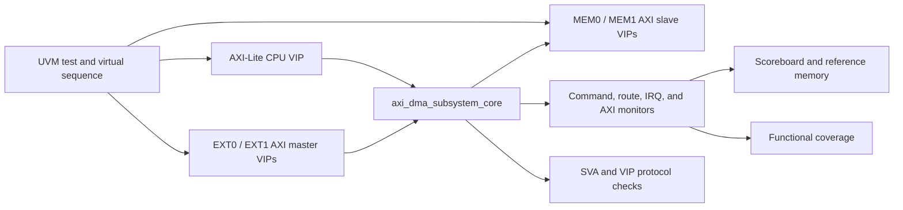

# AXI DMA Subsystem Verification

SystemVerilog/UVM verification environment for a dual-channel AXI4 DMA subsystem. The DUT combines two DMA channels, two external AXI masters, two memory targets, AXI-Lite control registers, AXI-Stream routing, completion tracking, and interrupt/status logic.

The complete RTL architecture and register behavior are documented in [docs/rtl_spec.md](docs/rtl_spec.md).

## Verification Status

The maintained regression contains 31 tests. The merged Synopsys VCS/URG baseline was generated on August 9, 2026 with VCS/URG `V-2023.12-SP2`.

| Metric | Result |
| --- | ---: |
| Regression | 31/31 PASS |
| Overall coverage score | 95.93% |
| Line | 99.36% |
| Condition | 93.60% |
| Toggle | 91.40% |
| FSM | 100.00% |
| Branch | 100.00% |
| Assertion, DUT hierarchy | 91.23% |
| Functional covergroups | 100.00% |

See the [functional verification report](docs/AXI4_DMA_Subsystem_Functional_Verification_Report.md) for results and the [coverage waiver rationale](docs/AXI_DMA_Subsystem_Coverage_Waiver_Rationale.md) for reviewed structural exclusions.

## Repository Layout

```text
axi_dma_subsystem_verification/
|-- rtl/                         RTL and vendored AXI/AXI-Stream components
|-- tb/
|   |-- tb_axi_dma_core_amd_vip.sv
|   |-- sva/                     Project protocol assertions
|   `-- uvm/                     Agents, environment, RAL, sequences, and tests
|-- sim/
|   |-- run_core_amd_vip.f       VCS source list
|   |-- run_vcs_core_amd_vip.sh  Compile, test, merge, and URG launcher
|   |-- cm_hier.cfg              Coverage hierarchy configuration
|   `-- exclusions/              Reviewed structural exclusions
`-- docs/                        RTL, test, coverage, dependency, and result documents
```

## Requirements

- Linux or a compatible Bash environment
- Synopsys VCS and URG `V-2023.12-SP2`
- UVM 1.2
- AMD/Xilinx AXI VIP generated with Vivado 2022.2

The generated VIP tree is selected with `AXI_VIP_HOME`. Its required layout is described in [docs/amd_axi_vip_external_dependency.md](docs/amd_axi_vip_external_dependency.md).

## Running the Verification Environment

Run commands from the `sim` directory.

### Full regression

```bash
./run_vcs_core_amd_vip.sh
```

The launcher compiles once, executes the maintained test list, merges coverage databases, and runs URG.

### One test

```bash
./run_vcs_core_amd_vip.sh +UVM_TESTNAME=dma_subsys_ch0_to_ch1_test
```

### URG from an existing coverage database

```bash
COV_DIR=/absolute/path/to/regression_timestamp.vdb \
URG_ONLY=1 \
./run_vcs_core_amd_vip.sh +UVM_TESTNAME=amd_axi_vip_smoke_test
```

### Unwaived coverage diagnostic

```bash
COVERAGE_EL= ./run_vcs_core_amd_vip.sh
```

## Verification Environment



The environment uses five AMD AXI VIP agents:

| Agent | Mode | Role |
| --- | --- | --- |
| AXI-Lite CPU | Master | Register access and AXI-Lite timing |
| EXT0, EXT1 | AXI4 masters | External traffic, path contention, burst types, and attributes |
| MEM0, MEM1 | AXI4 slaves | Memory data, latency, backpressure, and response injection |

The main checking components are:

- an independent sparse byte-addressable reference memory;
- an end-to-end scoreboard for commands, routes, AXI traffic, completions, registers, and interrupts;
- a UVM RAL model with passive bus prediction;
- project SVA bound to both memory-side AXI interfaces;
- AMD VIP protocol checking; and
- 11 functional covergroups covering control, routing, memory traffic, completion, interrupt, fault, and reset behavior.

## Tests and Coverage

The regression covers environment startup, RAL access, bidirectional transfers, all legal crossbar paths, completion ordering, route contention, transfer-length boundaries, AXI burst forms and attributes, AXI-Lite policy and timing, descriptor rejection, response errors, internal faults, abort behavior, interrupt masking, reset recovery, and tag/counter rollover.

- [Test scenarios](docs/AXI_DMA_Subsystem_Test_Scenarios.md)
- [Functional verification report](docs/AXI4_DMA_Subsystem_Functional_Verification_Report.md)
- [Coverage waiver rationale](docs/AXI_DMA_Subsystem_Coverage_Waiver_Rationale.md)
- [Coverage dashboard](docs/Coverage_report.png)

## Adding a Test

1. Add a virtual sequence under `tb/uvm/env/seq_lib/`.
2. Include it from `tb/uvm/env/dma_subsys_env_pkg.sv`.
3. Add a concrete test under `tb/uvm/tests/`.
4. Add the test source to `sim/run_core_amd_vip.f`.
5. Add the test name to `regression_tests` in `sim/run_vcs_core_amd_vip.sh`.
6. Publish the expected scoreboard intent before starting DUT activity.
7. Run the new test, the related scenario group, and the full regression.

For a new coverage item, define its sampling event and legal value space, then add or extend a scenario that exercises it.

## Documentation

| Document | Contents |
| --- | --- |
| [RTL specification](docs/rtl_spec.md) | Architecture, interfaces, configuration, registers, data flow, state machines, errors, interrupts, and reset. |
| [Test scenarios](docs/AXI_DMA_Subsystem_Test_Scenarios.md) | Stimulus, checks, and pass criteria for all maintained tests. |
| [Verification report](docs/AXI4_DMA_Subsystem_Functional_Verification_Report.md) | Regression, coverage, assertion, scoreboard, and sign-off results. |
| [Coverage waiver rationale](docs/AXI_DMA_Subsystem_Coverage_Waiver_Rationale.md) | Structural exclusion inventory and reachability analysis. |
| [AMD AXI VIP dependency](docs/amd_axi_vip_external_dependency.md) | Generated VIP layout, interfaces, and launcher configuration. |
| [AXI-Lite crossbar fix](docs/RTL_fix_intro.md) | DECERR and W-channel handshake correction. |

## License

See the repository-level license and the notices retained in vendored source files.
