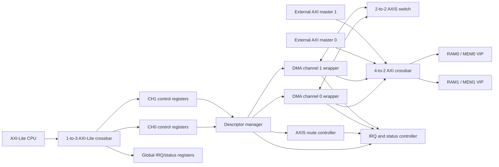
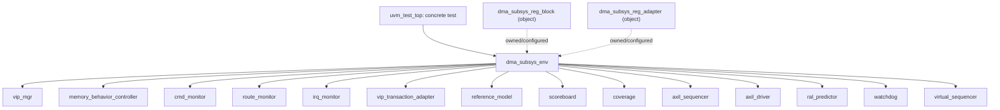

# AXI DMA Subsystem Verification

## 1. Purpose and baseline

This document describes the current subsystem-level RTL and UVM verification environment. It is intended to be the starting point for a new engineer or verification agent working on the project.

The documented baseline is the 31-test merged regression shown in the URG report generated on 2026-08-09 with Synopsys VCS/URG `V-2023.12-SP2`.

| Metric | Result |
|---|---:|
| Overall coverage score | 95.93% |
| Line | 99.36% |
| Condition | 93.60% |
| Toggle | 91.40% |
| FSM | 100.00% |
| Branch | 100.00% |
| Assertion | 87.16% |
| Functional covergroups | 100.00% |

The DUT hierarchy row reports assertion coverage of 91.23%. The lower assertion scores shown for `axi_vip_pkg` and `uvm_pkg` are tool/vendor package instrumentation, not DUT RTL coverage. They must not be used to judge project SVA quality.

## 2. RTL architecture

### 2.1 Fixed configuration

The main constants are declared in `rtl/dma_subsystem_pkg.sv`.

| Item | Current configuration |
|---|---|
| DMA channels | 2: DMA0 and DMA1 |
| External AXI masters | 2: EXT0 and EXT1 |
| AXI crossbar | 4 source ports to 2 memory targets |
| AXI width | 32-bit address, 32-bit data, 4-bit input ID |
| Crossbar output ID | 6 bits; includes source-port identification |
| DMA maximum burst | 16 beats |
| AXI-Lite | 32-bit address and data, 4-KiB block windows |
| AXI Stream | 32-bit data, 4-bit KEEP, 2-bit ID, 1-bit DEST/USER |
| Descriptor length | 20 bits |
| Software/hardware tag | 8 bits |
| Per-channel stream FIFO | 32 beats |
| Scatter-gather | Disabled (`ENABLE_SG=0`) |
| Unaligned DMA | Disabled (`ENABLE_UNALIGNED=0`) |
| Version value | `0x0001_0000` |

Memory map:

| Target | Inclusive address range |
|---|---|
| RAM0 | `0x0000_0000` to `0x0000_FFFF` |
| RAM1 | `0x1000_0000` to `0x1000_FFFF` |

AXI-Lite register blocks:

| Block | Base address |
|---|---:|
| DMA channel 0 | `0x0000_0000` |
| DMA channel 1 | `0x0000_1000` |
| Global IRQ/status | `0x0000_2000` |

Each channel contains CTRL, STATUS, SRC, DST, LENGTH, ROUTE, SW_TAG, last-result, counter, and VERSION registers. The global block contains IRQ_STATUS, IRQ_ENABLE, IRQ_CLEAR, last-error and per-channel counters, ROUTE_STATUS, GLOBAL_VERSION, and FAULT_STATUS.

### 2.2 Data and control topology



The descriptor-manager state flow is:

```text
IDLE -> VALIDATE -> WAIT_ROUTE -> ISSUE_WR_DESC -> ISSUE_RD_DESC
     -> WAIT_STATUS -> COMPLETE -> IDLE
                         \-> ERROR_RECOVERY -> IDLE
```

The manager validates channel enable, length, alignment, address range, overlap, busy state, and route legality. It allocates hardware tags, issues read/write descriptors, checks returned tags and lengths, maps AXI response errors, classifies aborts, and produces completion/fault records.

The route controller maintains one owner per destination, arbitrates competing requests, tracks release, and reports inconsistent ownership. The IRQ controller independently stores done, error, and manager-fault pending state and combines those states with enable masks to generate channel and global IRQ outputs.

### 2.3 Core and RAM wrappers

`axi_dma_subsystem_core` contains the integration logic and exposes memory-side AXI interfaces. The production-style wrapper adds two synthesizable 64-KiB AXI RAMs. The AMD VIP testbench instantiates the core directly and substitutes MEM0/MEM1 slave-memory VIPs. This preserves the core behavior while allowing deterministic delay, backpressure, response-error injection, and passive observation.

### 2.4 Imported AXI-Lite crossbar correction

`rtl/vendor/verilog_axi/axil_crossbar_wr.v` contains one intentional patch to imported Alex Forencich RTL. An unmapped AXI-Lite write could previously generate local DECERR `BVALID` before the associated W-channel handshake. The current logic keeps a local W-credit count and permits the DECERR response only after the write data is accepted. It also prevents a local DECERR from consuming a downstream response.

This patch was exposed by `dma_subsys_register_access_policy_test`. Preserve it when refreshing vendor RTL and rerun both the register-policy and AXI-Lite timing tests after any update.

## 3. Static testbench and AMD VIP

`tb/tb_axi_dma_core_amd_vip.sv` owns the clock, reset, DUT instance, generated VIP instances, passive internal probes, restricted negative-test hooks, and memory-side SVA bindings.

The design uses five generated AMD/Xilinx VIPs:

| Role | Static path |
|---|---|
| AXI-Lite CPU master | `tb_axi_dma_core_amd_vip.u_axil_cpu_vip.inst` |
| External AXI master 0 | `tb_axi_dma_core_amd_vip.u_ext_m0_vip.inst` |
| External AXI master 1 | `tb_axi_dma_core_amd_vip.u_ext_m1_vip.inst` |
| Memory slave 0 | `tb_axi_dma_core_amd_vip.u_mem0_vip.inst` |
| Memory slave 1 | `tb_axi_dma_core_amd_vip.u_mem1_vip.inst` |

The generated VIP source is deliberately excluded from the public repository for license and copyright reasons. It remains available in the Linux VM. The launcher locates it through `AXI_VIP_HOME`, whose default is `${HOME}/Desktop/verify_study/vip`.

Only the static testbench refers to generated hierarchy such as `.inst.IF`. It puts the interface handles into `dma_subsys_vip_cfg` and publishes that configuration through `uvm_config_db`. Package classes use the supplied handles and contain no upward hierarchical references.

The VIP manager starts both memory slave agents before the CPU and external master agents. This ordering prevents an unowned or X-valued READY response during startup. Default memory behavior is deterministic: no intentional backpressure, zero B/R delay, and `0xA5A5_A5A5` for unwritten words. Directed sequences may temporarily change delays or response modes.

## 4. UVM environment

### 4.1 Component tree



### 4.2 Component responsibilities

| Component | Responsibility |
|---|---|
| `dma_subsys_env_cfg` | Shared timeout and checking policy: 2,000-cycle VIP timeout, 1,000 status polls, 200,000-cycle watchdog, and 4,096-cycle route wait by default. |
| `dma_subsys_vip_manager` | Creates, starts, validates, and exposes the five typed AMD VIP agents. |
| `dma_subsys_memory_behavior_controller` | Applies deterministic memory response delays, READY behavior, and error injection. |
| `dma_subsys_axil_sequencer` / `driver` | Converts project register items into public AMD AXI-Lite API calls. |
| `dma_subsys_virtual_sequencer` | Holds all lower-level handles needed by a system sequence; it coordinates but does not drive pins. |
| `dma_subsys_cmd_monitor` | Publishes accepted commands and assigned hardware tags. |
| `dma_subsys_route_monitor` | Publishes request, grant, wait, release, ownership, and route-fault events. |
| `dma_subsys_irq_monitor` | Publishes completion, IRQ, pending/enable, fault, busy, and reset events. |
| `dma_subsys_vip_transaction_adapter` | Converts AMD monitor transactions into project-owned register and memory transactions. |
| `dma_subsys_ref_model` | Maintains independent sparse byte-addressable expected memory. |
| `dma_subsys_scoreboard` | Correlates intent, accepted command, route, bus traffic, completion, register state, and IRQ. |
| `dma_subsys_coverage` | Samples 11 system-domain functional covergroups. |
| `uvm_reg_predictor` | Updates the RAL mirror from transactions actually observed on AXI-Lite. |
| `dma_subsys_watchdog` | Detects global hangs and excessive route wait. |

The monitors are intentionally separated by domain. Command acceptance, routing, memory traffic, completion/IRQ, and reset have different clocks of interest, correlation keys, and ownership rules. Small passive monitors reduce race-prone shared state and make failures easier to localize.

### 4.3 Scoreboard and reference model

The scoreboard compares three independent sources:

1. Test intent published by the virtual sequence.
2. Actual activity observed by AMD VIP and passive internal monitors.
3. Expected bytes and state held by the independent reference model.

External VIP initialization also updates the reference model. When the DUT accepts a command, the scoreboard matches source, destination, route, length, software tag, and assigned hardware tag. Memory-side traffic is associated with DMA0, DMA1, EXT0, or EXT1 by decoding the widened crossbar ID. Expected bytes are copied from the reference memory and committed to the expected destination only after the modeled operation completes.

Completion checking covers owner, hardware/software tag, error, completed length, abort classification, route release, and IRQ state. Reset removes active flow and route expectations without erasing modeled RAM contents.

`[SCB_SUMMARY]` counters are diagnostic only. A test passes only when UVM error/fatal counts are zero and scoreboard `check_phase` finds no unmatched intent, active flow, route leak, or incomplete comparison.

### 4.4 RAL

`dma_subsys_reg_block` contains CH0, CH1, and global sub-blocks on one 4-byte little-endian frontdoor map. The map is bound to `dma_subsys_axil_sequencer` through `dma_subsys_reg_adapter`.

Automatic prediction is disabled. A passive `uvm_reg_predictor` updates mirrored values from observed AXI-Lite transactions, so the mirror represents what occurred on the bus instead of what a sequence merely requested. The UVM 1.2 `UVM/RSRC/NOREGEX` warnings caused by dotted RAL resource names are known and benign.

### 4.5 Virtual sequences

`dma_subsys_vseq_base` supplies common services for:

- waiting for VIP readiness and reset release;
- raw or strict AXI-Lite reads and writes;
- RAL frontdoor access;
- source-memory initialization and destination readback;
- FIXED, INCR, and WRAP AXI burst generation through EXT0/EXT1;
- payload generation and byte comparison;
- channel programming, start, abort, clear, and bounded polling;
- memory delay/error configuration;
- reset and restricted negative-test control;
- scoreboard intent publication; and
- the standard `run_dma_case` flow.

A concrete test is intentionally thin: it constructs one virtual sequence and starts it on `env.virtual_sequencer`.

## 5. Assertions

`tb/sva/dma_subsys_axi_sva.sv` is bound to both memory-side AXI interfaces. It checks:

- request VALID clearing after reset;
- AW, W, AR, B, and R payload stability while stalled;
- absence of X/Z values on every valid channel;
- legal AWSIZE and ARSIZE;
- non-reserved burst encodings;
- maximum FIXED burst length;
- legal WRAP burst lengths; and
- the AXI 4-KiB boundary rule for INCR traffic.

Cover properties record AW/W/AR backpressure and FIXED/WRAP burst activation. AMD VIP remains the primary protocol checker; these project assertions provide a vendor-independent integration safety net.

## 6. Coverage model

### 6.1 Functional coverage

Functional coverage records verification intent and protocol scenarios. All 11 covergroups are at 100% in the current merged regression.

| Covergroup | Main dimensions |
|---|---|
| `command_cg` | Accepted source/destination, length classes, and route cross. |
| `intent_cg` | Intended route/length, all modeled result classes, and expected accept/completion/IRQ behavior. |
| `register_cg` | Register block/address, access kind, WSTRB class, response, and access-response cross. |
| `memory_cg` | DMA0/DMA1/EXT0/EXT1 origin, RAM0/RAM1 target, read/write, response, and path crosses. |
| `memory_protocol_cg` | Burst type/length, bytes per beat, ID, alignment, page position, 4-KiB rule, strobe, and malformed-traffic checks. |
| `route_cg` | Request/grant/release/fault, source/destination, wait class, and path cross. |
| `completion_cg` | Owner, result/error type, abort state, and owner-abort cross. |
| `completion_order_cg` | Issue order, completion order, reordering, and concurrent pending depth. |
| `irq_cg` | Pending/enables, channel/global IRQ, cause combinations, masking, and consistency. |
| `fault_cg` | Manager/route fault type, source, and enable state. |
| `reset_cg` | Assert/deassert, boot/repeated epoch, and idle/active context. |

Functional 100% means every specified bin has been sampled; it does not imply complete RTL structural coverage.

### 6.2 Code coverage

VCS instruments line, condition, toggle, FSM, branch, and assertion coverage. URG additionally renders `group` coverage. Code coverage is limited to `tb_axi_dma_core_amd_vip.dut` by `sim/cm_hier.cfg`; imported vendor modules are excluded from the code-closure target because they are third-party implementations and heavily parameterized instances can dominate or destabilize the report.

The reviewed file `sim/exclusions/subsystem_unreachable.el` removes only audited unreachable structural objects. It is applied with `-excl_strict`, so a stale checksum or changed elaboration fails visibly instead of silently applying the wrong waiver.

The current residual gaps are expected principally in condition/toggle and assertion activation. Do not waive a residual only to improve a number. First determine whether it is reachable through a legal public interface; add a test if reachable, and waive it only when a configuration invariant or formal timing dependency proves it unreachable.

## 7. Build, regression, and reports

Run from the Linux project `sim` directory:

```bash
# Compile once, execute all 31 maintained tests, merge coverage, and run URG
./run_vcs_core_amd_vip.sh

# Execute one named test
./run_vcs_core_amd_vip.sh +UVM_TESTNAME=dma_subsys_ch0_to_ch1_test

# Generate only an URG report from an existing VDB
COV_DIR=/absolute/path/to/regression_timestamp.vdb \
URG_ONLY=1 \
./run_vcs_core_amd_vip.sh +UVM_TESTNAME=amd_axi_vip_smoke_test

# Produce an unwaived diagnostic report
COVERAGE_EL= ./run_vcs_core_amd_vip.sh
```

The default metrics are `line+cond+tgl+fsm+branch+assert` during collection and the same metrics plus `group` in URG. VCS `V-2023.12-SP2` has shown intermittent URG status-139 crashes. The launcher preserves the VDB and falls back to smaller metric sets for visibility, but a line-only fallback is not a full closure report. Retry the full report before changing RTL or deleting a valid VDB.

All shell, file-list, configuration, HDL, and Markdown files must retain Unix LF line endings.

## 8. Adding a new test or component

For a new directed scenario:

1. Add a virtual sequence under `tb/uvm/env/seq_lib/`.
2. Include the sequence from `dma_subsys_env_pkg.sv`.
3. Add a thin concrete test under `tb/uvm/tests/`.
4. Add the test `.sv` file to `sim/run_core_amd_vip.f`.
5. Add the test name to `regression_tests` in `sim/run_vcs_core_amd_vip.sh`.
6. Publish explicit scoreboard intent before starting the DUT operation.
7. Use public RAL/VIP APIs first; use `dma_subsys_test_ctrl_if` only for otherwise unreachable defensive paths.
8. Run the single test, then the complete regression, then review the merged functional and code coverage.

For a new monitor or checker, add a project transaction type, analysis port/implementation, package include, environment construction, and environment connection. Keep monitor classes passive and keep all HDL hierarchy references in the static testbench.

For a new functional coverage point, document its requirement, legal/illegal/ignored domains, sampling source, and closing test. Avoid implicit default-bin tricks and SystemVerilog keywords in bin names; the project convention prefixes a colliding name with `_`.

## 9. Final repository dependencies

The final reproducible coverage flow depends on:

- the RTL, UVM, test, SVA, and authoritative `.f` files;
- `sim/run_vcs_core_amd_vip.sh`;
- `sim/cm_hier.cfg`;
- `sim/exclusions/subsystem_unreachable.el`;
- the generated AMD VIP tree in the Linux VM, selected by `AXI_VIP_HOME`; and
- Synopsys VCS/URG and UVM 1.2.

Waiver-generation Python/shell helpers, temporary full-exclusion templates, `attempts.log`, VDB directories, and generated HTML reports are review artifacts rather than runtime dependencies. They may be archived outside the final repository. The reviewed `.el` file itself must remain.

## 10. Sign-off interpretation

The current baseline demonstrates 100% functional-group, FSM, and branch coverage, with greater than 90% line, condition, and toggle coverage after reviewed exclusions. This is a strong closure point, but sign-off still requires the regression summary and UVM logs to be clean. Coverage percentages never replace protocol, scoreboard, or assertion correctness.
