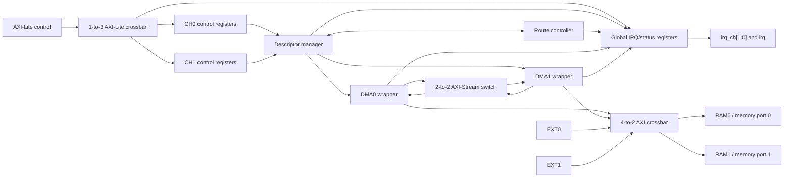
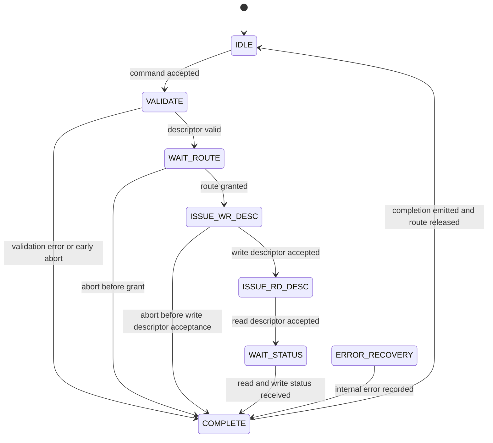

# AXI4 DMA Dual-Channel Subsystem RTL Specification

## 1. Overview

The AXI4 DMA subsystem moves byte ranges between two memory windows through two independently programmed DMA channels. It also exposes two external AXI master inputs that share the same memory crossbar. Software programs the DMA channels through AXI4-Lite and receives per-channel and global completion, error, fault, busy, and interrupt status.

The subsystem contains:

- two DMA channels, DMA0 and DMA1;
- two external AXI masters, EXT0 and EXT1;
- one 4-to-2 AXI crossbar;
- one 1-to-3 AXI-Lite crossbar;
- one 2-to-2 AXI-Stream switch;
- one control-register block per DMA channel;
- a two-lane descriptor manager;
- a destination route controller; and
- a global interrupt and status controller.

## 2. RTL Hierarchy

### 2.1 Top-level modules

| Module | Role |
| --- | --- |
| `axi_dma_subsystem_core` | Reusable subsystem core. It exposes AXI-Lite control, EXT0/EXT1 AXI inputs, two decoded memory-side AXI outputs, interrupts, and busy state. |
| `axi_dma_subsystem_ram_top` | Instantiates `axi_dma_subsystem_core` and two synthesizable 64 KiB AXI RAMs. |
| `axi_dma_subsystem_top` | Compatibility wrapper around `axi_dma_subsystem_ram_top`. |

### 2.2 Internal modules

| Module | Instances | Role |
| --- | ---: | --- |
| `dma_ctrl_regs` | 2 | Per-channel AXI-Lite register bank and command interface. |
| `dma_desc_manager` | 1 | Command validation, route acquisition, descriptor issue, status correlation, and completion generation. |
| `dma_axis_route_ctrl` | 1 | Destination ownership and round-robin arbitration. |
| `dma_channel_wrap` | 2 | AXI DMA engine plus read-side and write-side AXI-Stream FIFOs. |
| `dma_irq_status_ctrl` | 1 | Global status, counters, fault capture, interrupt enables, and interrupt outputs. |
| `axi_crossbar` | 1 | Connects DMA0, DMA1, EXT0, and EXT1 to RAM0 and RAM1. |
| `axil_crossbar` | 1 | Decodes the software control port to CH0, CH1, and GLOBAL register blocks. |
| `axis_switch` | 1 | Routes each DMA read stream to the selected DMA write stream. |

### 2.3 Architecture



## 3. Configuration

The package `dma_subsystem_pkg` defines the subsystem configuration.

| Item | Value |
| --- | --- |
| DMA channels | 2 |
| External AXI masters | 2 |
| AXI crossbar source ports | 4 |
| AXI memory targets | 2 |
| AXI address width | 32 bits |
| AXI data width | 32 bits |
| AXI input ID width | 4 bits |
| AXI crossbar output ID width | 6 bits |
| Maximum DMA burst | 16 beats |
| AXI-Lite address width | 32 bits |
| AXI-Lite data width | 32 bits |
| AXI-Lite block address width | 12 bits |
| AXI-Stream data / KEEP width | 32 / 4 bits |
| AXI-Stream ID / DEST / USER width | 2 / 1 / 1 bits |
| Descriptor length width | 20 bits |
| Descriptor tag width | 8 bits |
| Per-channel AXI-Stream FIFO depth | 32 beats |
| `ENABLE_SG` | `0` |
| `ENABLE_UNALIGNED` | `0` |
| Version | `0x0001_0000` |

Elaboration checks require two DMA channels, two external masters, four AXI sources, two memory targets, equal AXI and AXI-Stream data widths, a consistent crossbar ID width, a nonzero FIFO depth, and enough DEST bits to select a memory target.

## 4. External Interfaces

All interfaces use `clk` and active-high synchronous `rst`.

### 4.1 AXI4-Lite control interface

`s_axil_*` is a 32-bit AXI4-Lite slave interface. The internal AXI-Lite crossbar decodes one upstream control port into three 4 KiB register windows.

The register blocks accept AW and W independently, hold one address and one data item, and produce a response when both are present. Legal accesses return `OKAY`; invalid offsets inside a decoded register window return `SLVERR`; addresses outside all three windows are handled by the AXI-Lite crossbar as decode errors.

### 4.2 External AXI inputs

`s_axi_ext_*` contains two flattened AXI4 slave-facing port sets for EXT0 and EXT1. These ports allow independent external initiators to access RAM0 and RAM1 through the same crossbar used by the DMA engines.

### 4.3 Memory-side AXI outputs

`m_axi_mem_*` contains two flattened AXI4 master port sets:

| Index | Address window | Width |
| --- | --- | ---: |
| 0 | `0x0000_0000` to `0x0000_FFFF` | 64 KiB |
| 1 | `0x1000_0000` to `0x1000_FFFF` | 64 KiB |

The RAM-backed wrapper connects these ports to two `axi_ram` instances. Integrations may connect them to other AXI slaves with the same protocol and width configuration.

### 4.4 Status outputs

| Signal | Meaning |
| --- | --- |
| `subsys_busy[0]` | DMA0 descriptor manager is not idle. |
| `subsys_busy[1]` | DMA1 descriptor manager is not idle. |
| `irq_ch[0]` | Enabled CH0 completion or error is pending. |
| `irq_ch[1]` | Enabled CH1 completion or error is pending. |
| `irq` | Any channel interrupt or enabled global fault is active. |

## 5. Address Maps

### 5.1 AXI memory map

| Target | Base | End |
| --- | ---: | ---: |
| RAM0 | `0x0000_0000` | `0x0000_FFFF` |
| RAM1 | `0x1000_0000` | `0x1000_FFFF` |

Each accepted DMA source range and destination range must fit entirely inside one memory window.

### 5.2 AXI-Lite register map

| Block | Base address | Window |
| --- | ---: | ---: |
| DMA channel 0 | `0x0000_0000` | 4 KiB |
| DMA channel 1 | `0x0000_1000` | 4 KiB |
| Global IRQ/status | `0x0000_2000` | 4 KiB |

## 6. Per-Channel Registers

CH0 and CH1 use the same offsets. All counters saturate at `0xFFFF_FFFF`.

| Offset | Register | Access | Fields |
| --- | --- | --- | --- |
| `0x000` | `CTRL` | RW / command | `[0] START`, `[1] ABORT`, `[2] ENABLE`, `[4] CLEAR_STATUS` |
| `0x004` | `STATUS` | RO | `[0] BUSY`, `[1] DONE_PENDING`, `[2] ERROR_PENDING`, `[3] CMD_PENDING`, `[4] ABORT_SEEN`, `[15:8] LAST_ERROR` |
| `0x008` | `SRC_ADDR` | RW | Source byte address |
| `0x00C` | `DST_ADDR` | RW | Destination byte address |
| `0x010` | `LENGTH` | RW | `[19:0]` transfer length in bytes |
| `0x014` | `ROUTE` | RW | `[0]` destination DMA channel |
| `0x018` | `SW_TAG` | RW | `[7:0]` software tag |
| `0x01C` | `LAST_HW_TAG` | RO | `[7:0]` hardware tag from the latest completion |
| `0x020` | `COMPLETED_LEN` | RO | `[19:0]` completed write length |
| `0x024` | `LAST_ERROR` | RO | `[7:0]` latest completion or command error |
| `0x028` | `CMD_COUNT` | RO | Accepted command count |
| `0x02C` | `DONE_COUNT` | RO | Completion count |
| `0x030` | `VERSION` | RO | `0x0001_0000` |

### 6.1 Control commands

Command bits are write-one operations in byte lane 0.

- `START` captures the staged source address, destination address, length, destination channel, and software tag into a command.
- `ABORT` removes a pending command when possible or marks an active command as aborted.
- `ENABLE` is a persistent channel-enable bit and honors AXI-Lite byte strobes.
- `CLEAR_STATUS` clears per-channel completion, error, abort, and last-error state.

A disabled `START` records `DMA_ERR_DISABLED`. A `START` while the manager is busy or a command is pending records `DMA_ERR_BUSY`.

### 6.2 Completion state

Each completion updates `DONE_PENDING`, `LAST_HW_TAG`, `COMPLETED_LEN`, `LAST_ERROR`, `ABORT_SEEN`, and `DONE_COUNT`. A nonzero completion error also sets `ERROR_PENDING`.

## 7. Global IRQ and Status Registers

| Offset | Register | Access | Fields |
| --- | --- | --- | --- |
| `0x000` | `IRQ_STATUS` | RO | `[1:0] DONE_PENDING`, `[9:8] ERROR_PENDING`, `[17:16] BUSY`, `[30] FAULT_PENDING`, `[31] ANY_STATUS` |
| `0x004` | `IRQ_ENABLE` | RW | `[1:0] DONE_ENABLE`, `[9:8] ERROR_ENABLE`, `[30] FAULT_ENABLE` |
| `0x008` | `IRQ_CLEAR` | WO | Write one to clear matching done, error, or fault pending bits |
| `0x00C` | `IRQ_LAST_ERROR` | RO | `[7:0] CH0_LAST_ERROR`, `[15:8] CH1_LAST_ERROR` |
| `0x010` | `CH0_DONE_COUNT` | RO | CH0 completion count |
| `0x014` | `CH1_DONE_COUNT` | RO | CH1 completion count |
| `0x018` | `CH0_ERROR_COUNT` | RO | CH0 error-completion count |
| `0x01C` | `CH1_ERROR_COUNT` | RO | CH1 error-completion count |
| `0x020` | `ROUTE_STATUS` | RO | `[3:0]` source-to-destination route matrix, `[5:4]` active sources |
| `0x024` | `GLOBAL_VERSION` | RO | `0x0001_0000` |
| `0x028` | `FAULT_STATUS` | RO | `[7:0] FAULT_CODE`, `[10:8] FAULT_SOURCE` |

`ANY_STATUS` is high when any done, error, busy, or fault-pending bit is set. It is a status summary and is independent of interrupt enables.

The interrupt equations are:

```text
irq_ch[n] = (done_pending[n]  && done_enable[n])
          || (error_pending[n] && error_enable[n])

irq = irq_ch[0] || irq_ch[1] || (fault_pending && fault_enable)
```

Pending bits are sticky until cleared. If a completion or fault arrives on the same cycle as a clear, the newly observed event sets the corresponding pending bit.

`IRQ_ENABLE` honors byte strobes. `IRQ_CLEAR` clears done bits only when byte lane 0 is enabled, error bits only when byte lane 1 is enabled, and the fault bit only when byte lane 3 is enabled.

## 8. Command and Completion Formats

### 8.1 Command

`dma_cmd_t` contains:

| Field | Width | Meaning |
| --- | ---: | --- |
| `src_addr` | 32 | Source byte address |
| `dst_addr` | 32 | Destination byte address |
| `len` | 20 | Transfer length in bytes |
| `src_ch` | 1 | Owning DMA channel |
| `dst_ch` | 1 | Destination DMA channel and AXI-Stream output |
| `sw_tag` | 8 | Software-provided tag |

### 8.2 Completion

`dma_completion_t` contains:

| Field | Width | Meaning |
| --- | ---: | --- |
| `owner_ch` | 1 | Channel that accepted the command |
| `hw_tag` | 8 | Hardware-generated channel and sequence tag |
| `sw_tag` | 8 | Original software tag |
| `completed_len` | 20 | Length reported by the destination write engine |
| `error` | 8 | Final subsystem error code |
| `aborted` | 1 | An abort was observed for the command |

The hardware tag is `{channel_index, sequence[6:0]}`. Each channel advances its own 7-bit sequence when it accepts a command.

### 8.3 Fault record

`dma_fault_t` contains an 8-bit error code and a 3-bit source. Fault sources identify read-status lane 0, read-status lane 1, write-status lane 0, write-status lane 1, route control, or descriptor-manager control.

## 9. Descriptor Processing

Each channel has an independent descriptor-manager state machine.



### 9.1 Validation order

Validation reports the first applicable error in this order:

1. zero length;
2. unaligned source when unaligned operation is disabled;
3. unaligned destination when unaligned operation is disabled;
4. source-channel ownership mismatch;
5. source range outside a single RAM window;
6. destination range outside a single RAM window; and
7. overlapping source and destination byte ranges.

Adjacent ranges are legal. Transfer lengths do not need to be multiples of the 32-bit data width; AXI-Stream KEEP and AXI WSTRB select the valid bytes in a partial final beat.

### 9.2 Execution sequence

1. A channel register block presents a command while its manager lane is idle.
2. The manager captures the command and allocates a hardware tag.
3. The manager validates the descriptor.
4. The route controller grants exclusive ownership of the selected destination stream.
5. The manager issues the write descriptor to the destination DMA engine.
6. The manager issues the read descriptor to the source DMA engine.
7. Source data passes through the source read FIFO, the AXI-Stream switch, and the destination write FIFO.
8. The manager correlates read and write status by channel, tag, and length.
9. The manager emits one completion, releases the route, and returns to idle.

The write descriptor is issued before the read descriptor so the destination path is ready before source data is released.

## 10. AXI-Stream Routing

Each DMA wrapper has two AXI-Stream FIFOs:

- the read FIFO buffers data produced by the DMA read engine before the switch; and
- the write FIFO buffers switched data before the DMA write engine.

The 2-to-2 switch uses `TDEST` to select DMA0 or DMA1 as the destination. Both inputs can reach both outputs. Arbitration is round-robin, and the switch preserves TID rather than rewriting it.

The route controller prevents two active source channels from owning the same destination. It maintains:

- one owner-valid bit and owner source for each destination;
- one active bit and selected destination for each source; and
- one round-robin pointer for each destination.

A request for a free destination is granted according to the destination's round-robin pointer. Re-requesting an already active source-to-destination route is treated as an idempotent grant. Invalid source identity or inconsistent release generates `DMA_ERR_ROUTE_CONFLICT` from `DMA_FAULT_SRC_ROUTE`.

## 11. AXI Memory Interconnect

The AXI crossbar source order is DMA0, DMA1, EXT0, and EXT1. Every source can read and write both memory targets.

| Property | Configuration |
| --- | --- |
| Source ports | 4 |
| Target ports | 2 |
| Source threads | 2 per source |
| Source acceptance | 16 transactions per source |
| Target issue limit | 4 transactions per target |
| Regions per target | 1 |
| Read connectivity | Fully connected |
| Write connectivity | Fully connected |

The crossbar appends the source-port index to the 4-bit input ID, producing a 6-bit memory-side ID. Return traffic uses that expanded ID to reach the originating source and restores the original ID width at the source interface.

DMA-generated AXI traffic uses 32-bit data beats, INCR bursts, a maximum burst length of 16 beats, fixed DMA IDs, and the configured CACHE and PROT attributes. EXT0 and EXT1 expose programmable AXI ID, burst, size, cache, and protection fields through their external interfaces.

## 12. Error Handling

### 12.1 Error codes

| Code | Name | Meaning |
| ---: | --- | --- |
| `0x00` | `DMA_ERR_NONE` | Successful completion |
| `0x01` | `DMA_ERR_DISABLED` | START requested while the channel is disabled |
| `0x02` | `DMA_ERR_LEN_ZERO` | Transfer length is zero |
| `0x03` | `DMA_ERR_SRC_ALIGN` | Source address violates alignment policy |
| `0x04` | `DMA_ERR_DST_ALIGN` | Destination address violates alignment policy |
| `0x05` | `DMA_ERR_SRC_RANGE` | Source range is outside one legal memory window |
| `0x06` | `DMA_ERR_DST_RANGE` | Destination range is outside one legal memory window |
| `0x07` | `DMA_ERR_OVERLAP` | Source and destination ranges overlap |
| `0x08` | `DMA_ERR_BUSY` | START requested while a command is pending or active |
| `0x10` | `DMA_ERR_AXI_RD_SLVERR` | AXI read returned SLVERR |
| `0x11` | `DMA_ERR_AXI_RD_DECERR` | AXI read returned DECERR |
| `0x12` | `DMA_ERR_AXI_WR_SLVERR` | AXI write returned SLVERR |
| `0x13` | `DMA_ERR_AXI_WR_DECERR` | AXI write returned DECERR |
| `0x20` | `DMA_ERR_ROUTE_CONFLICT` | Route ownership or source identity conflict |
| `0x21` | `DMA_ERR_TAG_MISMATCH` | Returned status tag does not match the command |
| `0x22` | `DMA_ERR_UNEXPECTED_STATUS` | Status arrived without a matching active operation |
| `0x23` | `DMA_ERR_LEN_MISMATCH` | Write status length does not match the command |
| `0x30` | `DMA_ERR_ABORT_PENDING` | Command was aborted before active data movement |
| `0x31` | `DMA_ERR_ABORT_INFLIGHT_UNSUPPORTED` | Abort was requested after descriptor issue |
| `0xFF` | `DMA_ERR_INTERNAL` | Internal state or vendor-status encoding error |

### 12.2 Status mapping and priority

Vendor read status values 4 and 5 map to read `SLVERR` and `DECERR`. Vendor write status values 6 and 7 map to write `SLVERR` and `DECERR`. Other nonzero vendor status values map to `DMA_ERR_INTERNAL`.

When more than one error is observed, the completion retains the highest-ranked condition:

```text
INTERNAL
  > TAG_MISMATCH
  > LEN_MISMATCH
  > AXI write response error
  > AXI read response error
  > in-flight abort
  > pending abort
  > descriptor and route errors
  > NONE
```

Unexpected read or write status is reported as a global fault. If manager and route faults occur together, the manager fault is forwarded to the global status controller.

## 13. Abort Behavior

Abort behavior depends on the descriptor phase:

- a command canceled before execution completes with `DMA_ERR_ABORT_PENDING`;
- an abort while waiting for a route completes as a pending abort and releases any acquired route;
- an abort before write-descriptor acceptance completes as a pending abort;
- an abort after descriptor issue is recorded, but the vendor DMA write-abort input remains tied low and the transfer is allowed to reach terminal status;
- a completed active transfer with an observed abort reports `DMA_ERR_ABORT_INFLIGHT_UNSUPPORTED` unless a higher-priority error occurred.

## 14. Reset Behavior

Synchronous reset returns the subsystem to an idle, noninterrupting state.

- Channel register staging fields, status flags, counters, command valid, and abort pulses clear.
- Descriptor-manager state, tags, status tracking, route state, completions, and manager faults clear.
- Route ownership, round-robin pointers, route matrix, and route faults clear.
- Global pending bits, enables, counters, fault status, channel interrupts, and global interrupt clear.
- AXI-Stream FIFOs, DMA engines, AXI crossbars, and AXI-Lite crossbar receive the same reset.

The RAM contents are controlled by the instantiated memory implementation; resetting the subsystem control logic does not define a memory-clear operation.

## 15. Vendored RTL

The subsystem uses the following Alex Forencich RTL families under `rtl/vendor/`:

- AXI DMA read and write engines;
- AXI and AXI-Lite crossbars and register slices;
- AXI RAM;
- AXI-Stream FIFO, register, and switch; and
- common arbitration and priority-encoding blocks.

The local `axil_crossbar_wr.v` includes the subsystem's DECERR timing correction. An unmapped write response is held until the associated W-channel handshake has completed, and the local DECERR response path is isolated from downstream B responses. The behavior is described in [RTL_fix_intro.md](RTL_fix_intro.md).
